# AI_Resume_Analyzer

This project is a web-based AI Resume Analyzer designed to analyze resumes and provide career-related insights using PDF text extraction, keyword matching, regular expressions, and rule-based analysis. It allows users to upload their resumes in PDF format and select their target profession for personalized analysis.

The system extracts text from the uploaded resume, identifies technical and non-technical skills, detects important resume sections, calculates an ATS-style score, identifies missing skills for the selected profession, and recommends relevant job roles. It also supports job description matching, resume history, resume comparison, and printable analysis reports.

## How to Run the Project

### 📋 Prerequisites

1. Visual Studio Code (VS Code)

2. A web browser such as Google Chrome, Microsoft Edge, or Firefox

3. Live Server extension for VS Code

4. An existing resume in PDF format

5. Internet connection to load PDF.js from its CDN

6. Required libraries and tools:

          PDF.js
       
          JavaScript
       
          Browser Local Storage

No Python environment, Flask server, or database setup is required for the current client-side implementation.

### 🚀 Steps to Run

#### 1. Open the Project Folder

Open your existing AI Resume Analyzer project folder in VS Code.

#### 2. Check the Project Files

Ensure that the project includes the necessary files, such as:

      upload.html
      
      dashboard.html
      
      history.html
      
      compare.html
      
      report.html
      
      jobmatch.html
      
      js/analyzer.js
      
      js/upload.js
      
      js/history.js
      
      js/compare.js
      
      js/report.js
      
      js/jobMatcher.js

#### 3. Launch the Application

Install the Live Server extension in VS Code if it is not already installed. Right-click upload.html and select Open with Live Server.

#### 4. Upload a Resume

Select your target profession and upload a PDF resume.

#### 5. Analyze the Resume

Click Analyze Resume to extract the resume text and generate the analysis results.

#### 6. View the Results

The dashboard displays the ATS-style score, detected skills, resume sections, missing skills, improvement suggestions, and recommended jobs.

### 📝 Features

#### 1. 📂 PDF Resume Upload and Text Extraction

Users can upload resumes in PDF format.

      I. PDF file selection
      II. File name display
      III. PDF text extraction using PDF.js
      IV. Extracted text validation
      V. Analysis initiation through the web interface

#### 2. 🎯 Profession Selection

Users select their target career field before analyzing their resume.

Supported fields include:

      I. Software / IT
      II. AI and Machine Learning
      III. Data Science / Analytics
      IV. Business / Management
      V. Marketing / Sales
      VI. Finance / Accounting
      VII. Human Resources
      VIII. UI/UX / Design
      IX. Education / Teaching
      X. Healthcare
      XI. Law
      XII. Hospitality / Tourism
      XIII. Research
      XIV. Other

The selected profession guides the missing-skill analysis and recommended job roles using predefined profession profiles.

#### 3. 🔍 Skill Detection

The system searches extracted resume text for predefined technical and non-technical skills using keyword matching and regular expressions.

      I. Programming languages and web technologies
      II. AI, machine learning, and data analysis
      III. Business and management skills
      IV. Marketing and sales skills
      V. Finance and accounting skills
      VI. HR and recruitment skills
      VII. Design and creative skills
      VIII. Healthcare, education, law, and hospitality skills
      IX. General professional skills such as communication, teamwork, and leadership

#### 4. 📊 ATS-Style Score Calculation

The system calculates a resume score using predefined rules.

      I. Number of detected skills
      II. Presence of the Education section
      III. Presence of the Skills section
      IV. Presence of Projects
      V. Presence of Experience
      VI. Presence of Certifications
      VII. Presence of Achievements

The resulting score is displayed as a percentage along with a resume-strength rating.

#### 5. ❌ Profession-Specific Missing Skills

The analyzer compares detected resume skills with the predefined skills associated with the selected profession.

      I. Identifies skills from the selected profession's profile that were not detected
      II. Displays missing skills on the dashboard
      III. Helps users identify areas for further development
      IV. Uses profession-specific skill profiles rather than one fixed engineering skill list

#### 6. 💼 Recommended Job Roles

The system recommends predefined job roles based on the selected profession and the skills detected in the resume.

      I. Displays relevant job titles
      II. Calculates a skill-based match percentage for each role
      III. Shows matched skills
      IV. Shows missing skills for each recommended role
      V. Sorts recommendations by match percentage

#### 7. 🎯 Job Description Matching

Users can paste a job description to compare its recognized skills with those detected in their resume.

      I. Extracts recognized skill keywords from the job description
      II. Identifies matching resume skills
      III. Lists missing skills required by the description
      IV. Calculates a skill-based match percentage
      V. Displays the matching results on a separate page

#### 8. 💡 Resume Improvement Suggestions

The dashboard provides rule-based suggestions based on the detected resume sections and missing skills.

       I. Identifies missing Experience or Projects sections
       II. Highlights missing Certifications
      III. Suggests relevant skills to consider developing
      IV. Encourages users to include measurable achievements

#### 9. 🕘 Resume History and Comparison

The application stores previous resume analysis records in browser Local Storage.

      I. Displays previously analyzed resumes
      II. Stores the file name, ATS-style score, detected skills, date, and extracted resume text
      III. Allows users to clear saved history
      IV. Supports comparison of recent resume versions
      V. Helps users review changes between analyses

#### 10. 📄 Analysis Report

The report page presents the saved analysis results in a consolidated format.

      I. ATS-style score
      II. Detected skills
      III. Resume sections
      IV. Missing skills
      V. Detected certifications
      VI. Recommended job matches
      VII. Printable report through the browser's print function
      
#### 11. 🖥️ User-Friendly Interface

The web application provides a consistent interface for uploading resumes and exploring analysis results.

      I. Dark-themed upload page
      II. Profession-selection dropdown
      III. PDF upload area and file name display
      IV. Dashboard with analysis cards
      V. Dedicated history, comparison, report, and job-matching pages
      VI. Responsive styling for different screen sizes

### ⚙️ Technologies Used

#### 1. Programming Language

      I. JavaScript

#### 2. Frontend

      I. HTML5
      II. CSS3
      III. JavaScript

#### 3. PDF Processing

      I. PDF.js
      II. Browser File API

#### 4. Text Processing

    I. Keyword Matching
    II. Regular Expressions
    III. Rule-Based Text Analysis

#### 5. Resume Analysis

      I. Rule-Based ATS-Style Scoring
      II. Profession-Specific Skill Profiles
      III. Skill-Based Job Matching
      IV. Rule-Based Improvement Suggestions

#### 6. Data Storage
      
      I. Browser Local Storage
      II. JSON Serialization for storing analysis records

#### 7. Development Environment

      I. Visual Studio Code
      II. Live Server
      III. Google Chrome / Microsoft Edge / Firefox

## 🖥️ User Interface

The application contains the following main pages:

#### 1. Upload Resume: Upload a PDF and select the target profession.
 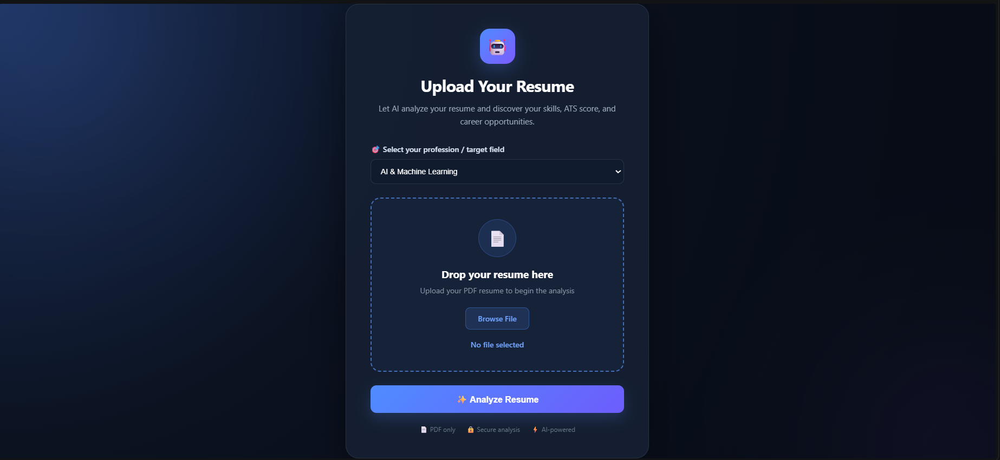

#### 2. Resume Analysis Dashboard: View scores, skills, resume sections, missing skills, suggestions, and job recommendations.
 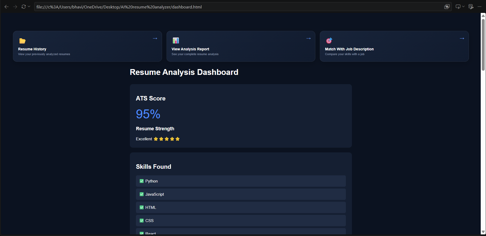

 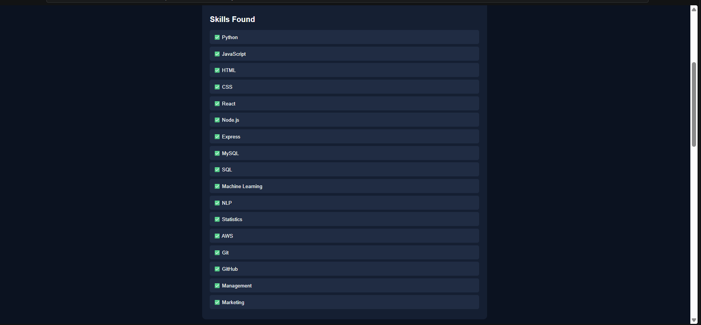

 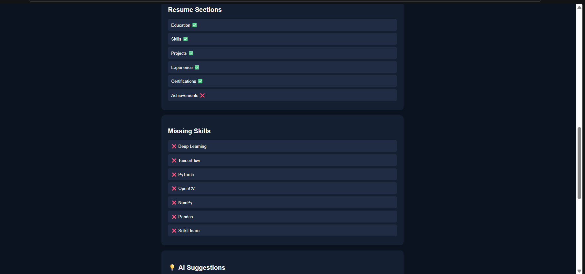
   
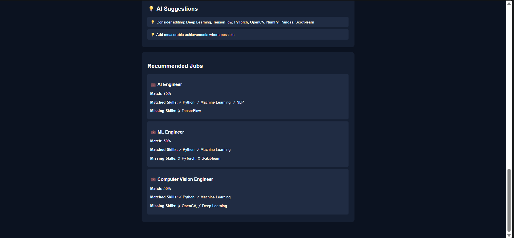

#### 3. Resume History: Review previous analyses and clear stored history.
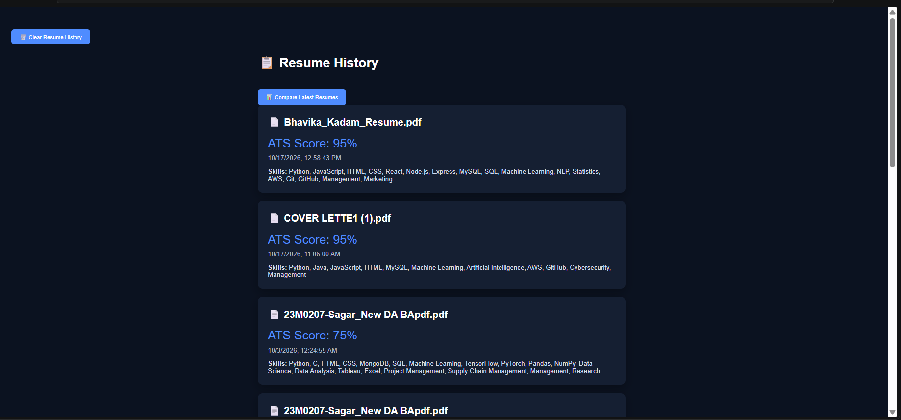

#### 4. Resume Comparison: Compare recent resume versions.
  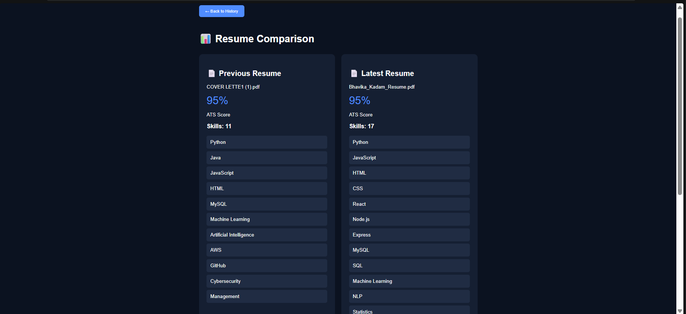

  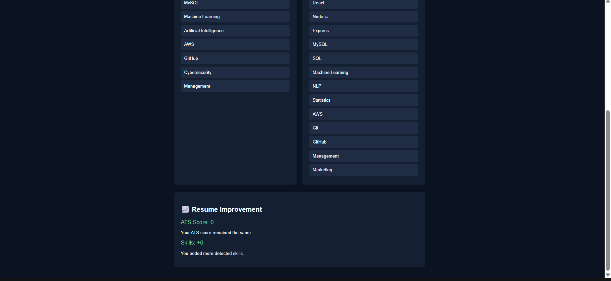

#### 5. Analysis Report: View and print a consolidated resume analysis.
  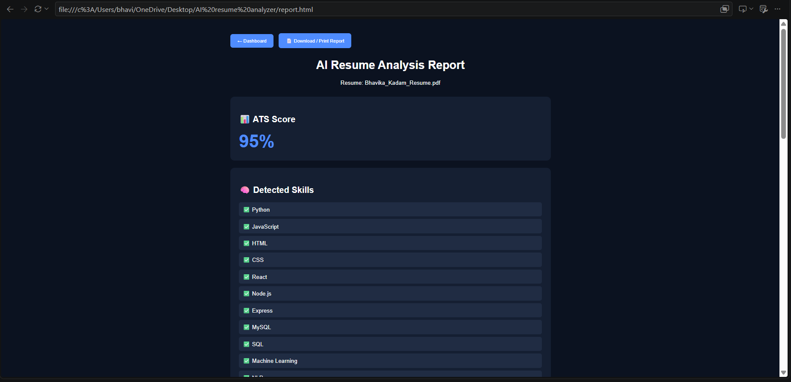

  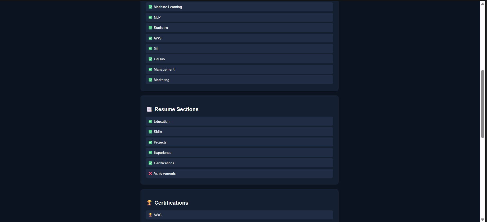

  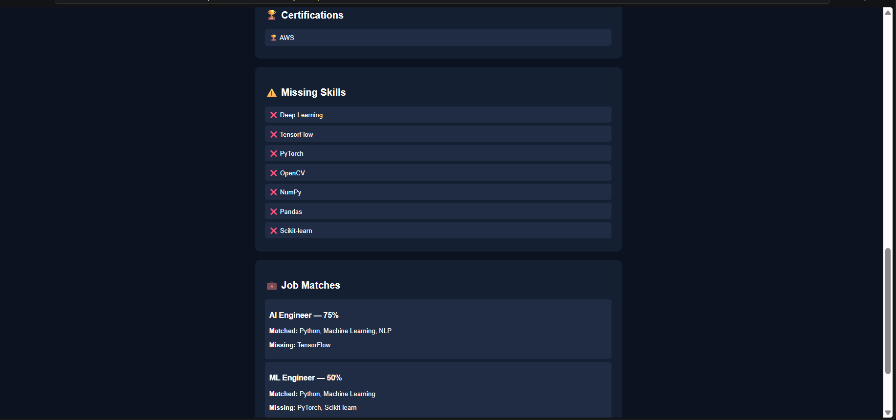

  #### 6.Job Description Matcher: Compare resume skills with a pasted job description.
   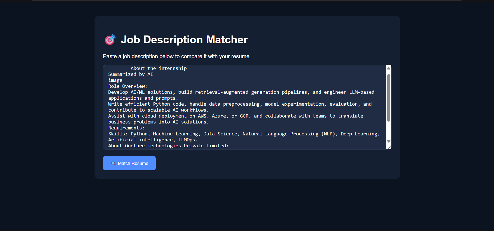

   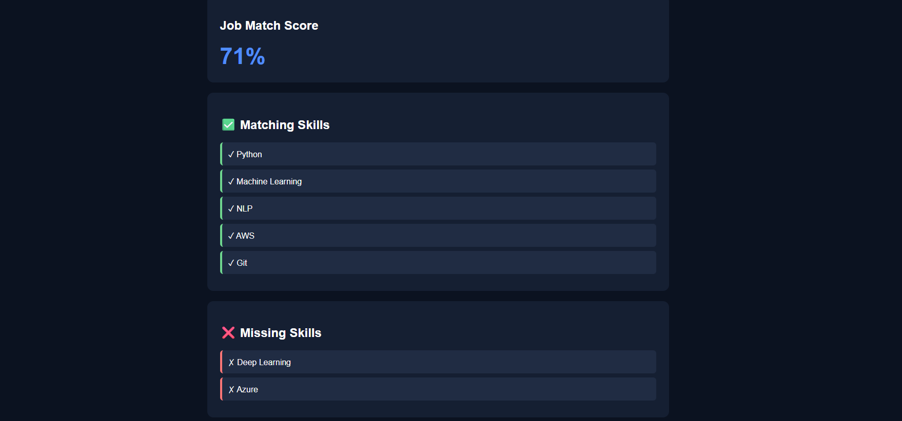
